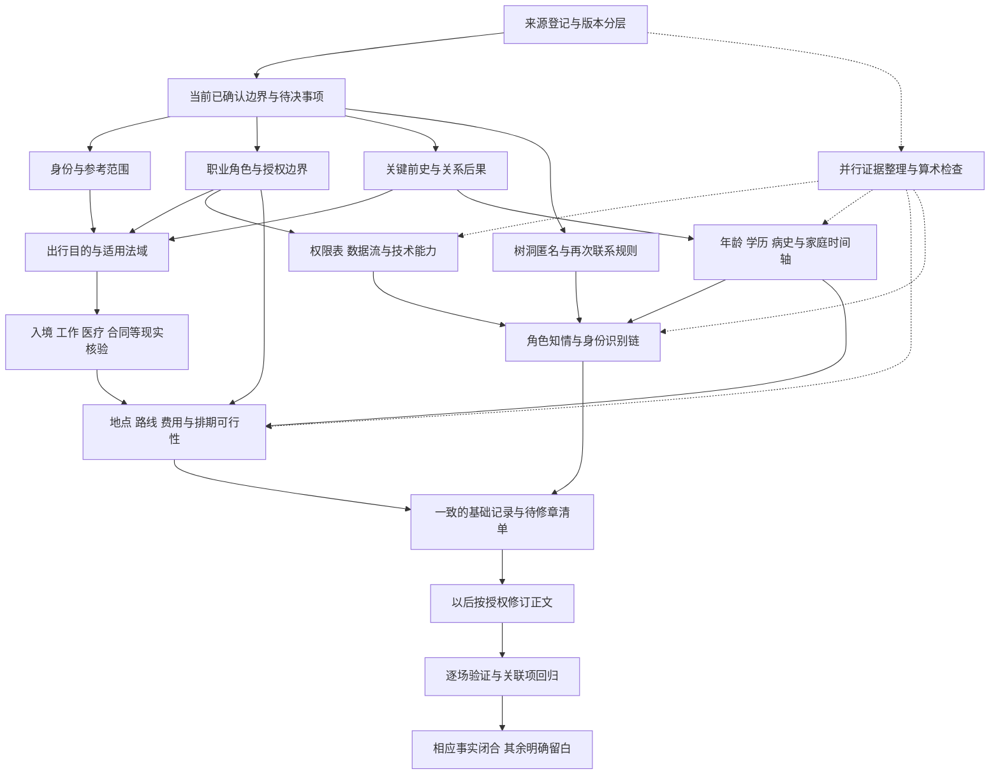

# 慢慢有风 设定依赖与验证规则

**版本提示：** 本页保留旧稿证据与上一轮分析。现行选择以[30本轮作者答复整合](../30_作者答复整合与当前审阅稿.md)为准：纯文字随机昵称树洞、四人团与已确认年龄、第一阶段分开留余地、内部T-Link，以及原Faisal改中文名并可进入竞争公司线。相反的旧推荐不再执行；旧资料引用仍按原版本保存。

**使用定位：历史诊断依赖与后续编辑验收，不是当前逐项问卷。** 当前作者决定见[13](../13_故事架构决策.md)，最新两项集中审阅见[25](../30_作者答复整合与当前审阅稿.md)。 作者已选择开始决定故事架构，本轮不再扩查来源或增加清单项目。可以先定架构，再按它触发的事实补证；本页的依赖和验收规则不要求先把所有基础项关闭，才开始讨论架构。

**让架构选择明确会改变故事的边界，再核它实际需要的现实条件，最后检查正文是否做到。** 本页配合[基础完整性清单](10_基础完整性清单.md)，说明缺口的先后关系、可以并行的整理工作，以及何时才可称某项逻辑闭合。它不新增剧情，不确定具体出行日期或章节，也不把旧资料的“锁定”自动当作作者今天重新确认。

## 依赖图

实线表示前提依赖；虚线表示可以并行整理，但结果仍须回到共同底表。旧资料发现任何冲突时，应回到相应节点，不以“找到一份旧设定”跳过选择与验证。

四个创作节点不是四份长问卷。已能从新找回资料确认的来源关系直接登记；只有仍冲突、会改变故事且未获编辑授权的内容才请作者选择。SP4RK采用aespa作为参考已获旧总体规划明示支持，不再列为“完全找不到”或重新要求整体参考确认；当前中文改名及沿用范围仍分级记录。参见[补充来源登记](10_基础完整性清单.md#补充来源登记)。

## 哪些先决定 哪些可以并行

| 工作链 | 先稳定的前提 | 前提稳定后做什么 | 现在可并行做什么 |
|---|---|---|---|
| 法律身份→跨境活动 | 两位主角法律国籍；短期首尔及台北阶段的出行目的、工作性质 | 查适用入境/居留/工作规则、保险和实际付款条件，再排住宿及费用 | 区分国籍/族裔/父母来源；列已写往返证据，不填许可类别、不定出发章 |
| 职业→权限→反诈结果 | 嘉弘正式岗位、公司业务、授权试点或有意越界 | 建角色权限、数据流、部署维护和警银交接，核实际法律与技术上限 | 拆组件、案件、金额和版本；标出现实权限没有解释的位置 |
| 前史→病史/学历→家庭关系 | 要保留的退学动机、重要疾病后果、谁参与照护及家庭关键关系 | 查病程、休学退学制度和费用，校年龄、陪护、A6及脚本起源 | 列全部矛盾版本和影响；不擅加第二次住院或第二本笔记本 |
| 树洞→互知→关系发展 | 静默触发、可见字段、重复匹配/联系边界、记录保留 | 写交互状态表，再检查身份识别和以后持续交流是否可能 | 分开安装/首用/首次互配/认出/现实见面，不自动复用旧分镜章号 |
| 团体角色→合同→推广排期 | 现役角色和许禾身份；谁代表哪个机构 | 整理契约、报酬费用、工作与休息、台北派驻与续约关系 | 归档四人艺名及中文表，保留强推定映射，不复制真人全部年龄与经历 |
| 地点/住处→行动→预算 | 已确认城市框架；需写的生活关系和各常用节点 | 核通勤、航程、医院、租金以及角色能否准时在场 | 画关系草图、列空间矛盾；400M含水电网先记旧值，不当新批准预算 |
| 来源→修订→验收 | 每一版本性质与采纳范围，当前作者决定 | 制作逐项待改清单，获授权后修订并回归验证 | 固定证据、校算术、检查重复实体与未来规划倒灌 |

**不等全部资料找完才整理，也不在前提未明时深查错对象。** 例如可以先把台湾工作情节所需字段列齐，但在国籍、雇主和工作性质未定时，不替人物选一种签证并据此反推剧情。出现明确的现实不可能时，把限制带回创作选择，不替作者暗改世界规则。

## 来源和状态的使用规则

### 1 来源效力按字段判断

- 当前作者明确选择优先用于该字段；授权内的编辑采用单独记载。当前确认“台北”不同时确认旧项目日期、同居或首次见面。
- 已完成正文是“发生过什么被写出”的证据，但正文可能互冲；规划是“曾想怎样写”的证据，不能冒充事件已发生。
- world_canon、state或文件中自称“锁定”“最高优先级”，只说明该版本当时的管理规则，不自动胜过作者新决定。旧稿30岁、广播系、台湾开场不能覆盖现阶段26岁、计算机相关前史待校、吉隆坡起点。
- 找到旧资料里的精确值，只能先把“缺失”更新为“文本明示（该版本）”。例如400M租金、1月1日生日、现役四艺名；是否采用、能否与现稿相容另判断。
- 新Mac资料的逐人映射分开登记：林冬/Winter与Karina的现实参考有明示；宁沐自称宁宁有正文；刘敏→Karina、纪小岚→Giselle是强交叉推定。不能把一列的明确程度复制给其他列。
- 外部官方来源说明现实制度，不选择人物国籍、恋情、家庭或故事后果。虚构公司可自设内部制度，但不能因此拥有不存在的公权力。
- 私人原始来源只在内部保留访问入口。公开稿用文件名、版本、资料日期、章号或行号定位，不出现私人云端链接、文件ID或电脑绝对路径。

### 2 状态变化需要相应证据

| 从何状态 | 何时可变化 | 不能凭什么变化 |
|---|---|---|
| 缺失→文本明示 | 新找到可定位的原文，注明版本与实际内容 | 搜索片段里只出现标题、文件名暗示功能、转录记录宣称原图有内容 |
| 推断→文本明示 | 出现直接陈述或明确对照；当前版本仍须注明 | 两人性格/担当相同、姓名相近、同城、同一币种金额接近 |
| 需作者决定→作者已确认 | 有作者针对该字段的明确选择 | 作者没反对、旧文件写canon、编辑推荐最省改动 |
| 需作者决定→编辑采用 | 作者明确授权了相应选择，编辑记录采用范围 | 仅授权整理、检索、分析，或授权年龄后顺带改国籍 |
| 矛盾→已选定但待修 | 冲突处理被采纳，并列出受影响处 | 仅把其中一处删出分析，或找到较晚文件就不看反证 |
| 需外部核验→已有核验记录 | 官方或合适专业来源适用时间、地点、对象均匹配；限制已记录 | 今天的博客数值、其他国家流程、一般常识或单一虚构角色说法 |
| 已选定/已有核验→单项闭合 | 底表、关联事实及获授权修订的正文都一致，复核有记录 | 只改底册、只通过算术、只在一章改对、只写“已完成” |

“已选定但待修”“已有核验记录”“单项闭合”是处理阶段，不替代清单的证据状态。保留“作者已确认/文本明示”等来源标签，使后续能解释某个值为何被采用。

### 3 搜索结束和资料完整是两回事

记录查过的位置、检索方式、可读文件、没找到的对象及未完成范围。电脑关键词全文扫描未完整结束，未找到旧100章、专门改名表或截图原图，都不能据此断言不存在。找到第055章也不能自动证明它与54章合集同版连续，或把第056章以后视为已找到。

state v2.2目前有JSON解析错误。可逐段引用可读文本并标版本，但不可作为可靠结构化状态输入；格式修复若获授权，应保留原件和修复日志。**修好JSON语法也不等于修好了日期、病史和匹配次数。** 不执行旧替换脚本或校验脚本来替代内容核查。

## 逐项验证规则

下列规则既用于底册，也用于以后经授权的正文修订。一次验证失败只回到受影响事实，不要求把全书重设。

| 规则ID | 必须成立的条件 | 不通过时的处理 | 对应清单 |
|---|---|---|---|
| VLD01 版本隔离 | 每条事实能定位到来源、版本及正文/规划/分析类型 | 标来源不明或待核，不跨版本拼成一条完整经历 | V01—V04、R03 |
| VLD02 决定范围 | 每个已采用值在作者确认或编辑授权范围内 | 改回建议/旧值，不连带认定无关字段 | V02、P02、R01 |
| VLD03 实体唯一 | 一个角色、案件、物件有稳定ID；别名有来由 | 保留候选关联，不凭同名、金额或地点合并 | P01、C06、O01 |
| VLD04 位置连续 | 人物每场所在城市、住处和迁移前后能串起来 | 记录缺桥；不从案源、口音、他人旅程推出搬家 | G01—G05、X03 |
| VLD05 空间可行 | 进门、听见、看到、持钥匙、床位和窗口符合选定平面关系 | 修对应动作或空间设定；不能每遇冲突都补一处新住址 | G03、O02 |
| VLD06 移动可行 | 门到门耗时、营业/交通时段和前后活动兼容 | 核路线与时段，需改故事节奏时回作者；不只看空中时长 | G04—G05、I05 |
| VLD07 时间有类型 | 明示日期、推定日期、回忆日期、计划日期分别标记 | 未定日期保区间；不按奇偶章补同日 | T02、T04 |
| VLD08 时区换算 | 同一瞬间的各地日期钟点经统一参考时间能互换 | 查跨午夜和日志时区；不把本地钟点差直接当时长 | T03、G05 |
| VLD09 年龄与前史 | 采用的周岁、入学/出道/签约与往事间隔可同时成立 | 保确认值，提出最少改动候选；不编生日、跳级或隐藏前团 | T01、T05、F02—F03、I02 |
| VLD10 计日口径 | “第几天”“几夜”“术后日”与实际起止及跨夜一致 | 先统一事件日期和计数定义，再改概括语 | T04、F04 |
| VLD11 数量与单位 | 金额、单位、数量、付款人、交易性质齐备且算术正确 | 缺规格先补规格，不用汇率掩盖错币种或错数量 | M01、M03—M04 |
| VLD12 预算闭合 | 可支配收入和支付时间支持已写支出及经济压力 | 找确有依据的资金来源；不得自动借款、获赠或公司全包 | M02、M05、I04 |
| VLD13 语言可用 | 角色具备当场说/读/写能力或有明确翻译方式 | 标理解范围或调整表达；不从国籍、代码、口音补熟练度 | L01—L02、H02—H03 |
| VLD14 权限可追溯 | 每个数据访问、部署、退款、冻结、签约由有相应权限的人实施 | 区分获授权、越界、猜测和虚张声势；相应后果不能省略 | W01—W06、I03—I06、C02 |
| VLD15 身份不越界 | 国籍、入境、停留和实际活动匹配相关法域与时点 | 等创作前提确定后核官方，不拿血缘或短期入境当工作许可 | P02、X01—X02 |
| VLD16 医疗教育合适 | 病程/学制、手续及费用与地点、年龄、时间和事件后果匹配 | 查专业/官方来源；不得用叙事需要替代诊断或学校政策 | F02—F04 |
| VLD17 家庭权利清楚 | 照护、继承、代理与处分权有具体主体和依据 | 亲属关系与法律权限分开；跨境法律问题单列待核 | F01、F05—F06、I04 |
| VLD18 产品状态可复演 | 同样输入在同一树洞版本产生同样计时、匹配和结束结果 | 先修状态规则，不能只给男女主特殊例外 | H01—H04 |
| VLD19 匿名范围准确 | 对方/本人/经营方/其他人能看什么分别明确 | 清空界面不写成物理删除；可截图/录音等风险不因匿名消失 | H02、H05—H06、I06 |
| VLD20 识别有证据 | 人物从线索到认人、认案的推理强度与可见信息匹配 | 口头习惯可形成怀疑，不自动构成唯一身份验证 | P04、H03、C02、O02 |
| VLD21 技术输入有限 | 系统结论只使用可取得且获准使用的输入；输出不超能力 | 补真实输入来源或降低断言，不能让算法凭空读账户/心情 | C01—C04、W05—W06 |
| VLD22 评测口径正确 | 样本构成、分母、指标和上线模式相匹配 | 现有90/123、112/123只称该集合命中；无误报数据不宣称总体精准率 | C05 |
| VLD23 状态变化有事件 | 停复机、版本、转岗、送出/收到、受助结果均有发生依据 | 把计划和承诺留为未完成，不因后章提及追认已发生 | W02、C04、C06、O03 |
| VLD24 知情受限 | 视角人物的断言和行动只用当时可知信息 | 角色猜测保猜测，不把读者、其他视角或未来规划的知识给他 | P04、N01、O04 |
| VLD25 参考有边界 | 现实参考、虚构经历、真实品牌/技术及文风来源分类明确 | 不用真人名字证明小说疾病、家庭、恋情或权限，不复制参考原文 | I01、R01—R03、N02 |
| VLD26 因果不跳步 | 触发→获知→动机→能力/资源→行动→结果之间有最少必要连接 | 标缺环，回前提修；新增大事件必须获得创作授权 | O04及其上游 |
| VLD27 关联回归 | 改了上游事实后，相关人物、时间、金钱、空间、物件和知识边界都再查 | 不只改搜索命中的词；记录受影响ID和仍未解决处 | 全表 |

## 五条最需要跑通的因果链

这些只是验收链，不是新剧情或章节安排。

1. **住院到退学再到脚本重启**：疾病与住院时点 → 课程/项目受影响 → 可选择的手续和费用 → 嘉弘实际选择 → 父母及阿豪知道到哪一层 → A6和技能来源 → 2026重新开发。三月/八月、年级、陪护与笔记本来源须在同一链中校验。
2. **一宗反诈的真实结果**：哪条公开/内部线索 → 如何核实当事人 → 为什么嘉弘能联系或介入 → 谁能看到交易 → 当事人采取什么行动 → 银行/警方做什么 → 最后损失/拦截/追回各多少。不能跳过授权或确认，直接由模型输出“钱已追回”。
3. **台湾推广的实际可行性**：所属机构与许禾角色 → 合同/邀请和项目目的 → 林冬实际法律身份及许可 → 费用/住宿/收入 → 原团工作与休息 → 往返 → 谁知道行程。保留项目不等于旧日期与三个月长度全部获批。
4. **匿名相识变为持续关系**：正常共同上线窗口、角色／语言可匹配 → 首次互配 → 多次随机匹配与回应 → 林冬凭开场白认出同一匿名对象并筛选，嘉弘只觉几位相似 → 首尔短遇 → 台北现实慢熟 → 分别对应现实身份并确认。方向已由作者新确认，n与匹配实现仍需核；认出声音不等于知道真实姓名。
5. **私人代码的工作冲突**：项目来源及劳动关系 → 实际使用/数据许可 → Eric提出什么要求 → 嘉弘具体拒绝了什么、向谁表达 → 技术访问实际是否改变 → 业务/法律/关系后果。A6里写“不授权”本身不能完成对外拒绝或撤销访问。

## 最小底册 不建立无用百科

可以使用同一组Markdown表，不要求新系统或每项另建文件。每条只保留有叙事作用的字段；未知值写未知或未设，不能写出看似精确的假日期。

| 记录 | 最少字段 | 可以继续留白的内容 |
|---|---|---|
| 来源与决定 | 来源ID、文件/版本/章行、性质、短证据；决定字段、决定内容、范围、受影响ID | 无关文件、私人访问路径、未经核实的来源猜想 |
| 人物与关系 | 人物ID/别名、现阶段身份、必需年龄/语言、关系起点、已知秘密及来源 | 无用途生日、详细地址、所有家属姓名和完整履历 |
| 时间与行程 | 事件ID、发生/叙述/计划、当地时间或区间、时区、地点、参与者、前后依赖 | 目前作者暂缓的具体出行日期、未使用的逐小时日程 |
| 空间与居住 | 常用节点、住户、必要房间/门窗/钥匙关系、通勤方式与范围 | 精确门牌、全城街道、没有动作使用的家具尺寸 |
| 金额与预算 | 币种、数额/范围、数量、付款人、毛净/成交/损失口径、时点、来源 | 不影响经济约束的全部资产和每笔零用消费 |
| 工作与权限 | 主体、岗位、动作、可见数据、批准人、设备/保存范围、责任 | 完整员工手册、所有职级、没出场的部门 |
| 家庭与健康 | 关键亲属、事件版本、照护/知情；病程后果、就医地点、必要康复限制及核验来源 | 无剧情用途的检查值、完整处方、家族所有疾病 |
| 产品与技术 | 规则版本、状态、输入、触发、输出、边界、失败/恢复、权限 | 未用到的服务架构、没出现的复杂功能 |
| 案件与物件 | 稳定ID、源事件、金额/状态、持有人/位置、交接/反馈、谁知道 | 普通水杯朝向、每次用量、没有用途的伏笔 |
| 修订与核验 | 清单ID、处理方案、依据、影响章、实施版本、验证项、剩余缺口 | 空泛“已优化”或无法复核的完成百分比 |

## 完成门槛与停止条件

**本轮覆盖审计完成**需要：所有必要领域已检查；每个关键缺口有优先级、证据、影响、下一步；来源扩查范围如实登记；作者输入压缩为少数创作边界。达到这一层，不代表小说底层事实已经全部闭合。

**某项基础事实可关闭**需要：

1. 当前采用值或明确“无叙事用途，保留空白”已记录，来源层级没有混用。
2. 所有已知互斥证据都有处置，不靠未写事件拼接；需要作者的决定已经得到，不以沉默代替。
3. 现实核验如有必要，来源对准故事时间、地点、对象与活动，核验范围和限制已写明。
4. 上下游记录均相容；涉及正文而尚未获授权修改时，只能标“底册已定，正文待修”，不能称正文已修好。
5. 已获授权修订的正文逐处验证通过，并记录版本；新找到反证可重新打开该项。

**整书底层可用于相应正文定稿**不是所有格子有值，而是所有P0及已写/将写情节会触发的P1都已闭合，P2和未用字段明确留白。这不是开始架构讨论的门槛；当前可先定架构，再处理它实际用到的缺口。具体章节与出行日期按作者要求留后；等待这些输入时可继续整理与核验已稳定前提，不虚构日期完成表格。

一次搜索无结果、找到一份canonical文件、修好损坏JSON、生成整套表格、统计完数量，均不是“所有事实齐全”的证据。停止某一核验的合理条件是对应问题已经有足够适用证据，或其余工作确实需要作者决定/未找到原件；此时明列阻碍，保留其他可以继续完成的工作。

---

[基础完整性清单](10_基础完整性清单.md) · [现有分析目录](../README.md) · [当前确认](../30_作者答复整合与当前审阅稿.md) · [既有来源](07_参考来源及SP4RK证据.md)
